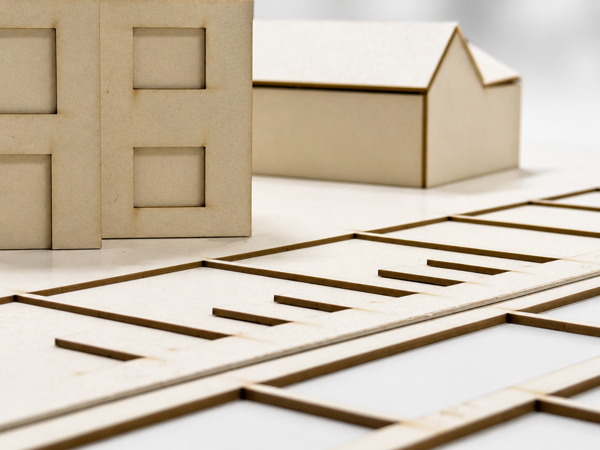
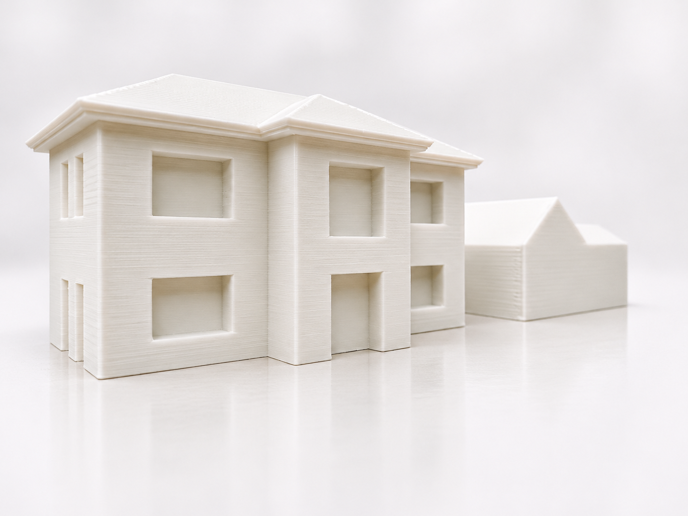

# hb-laserplus

**Zur Website: https://jade-hs-vibecoding-wpk.github.io/hb-laserplus/**

Eine Webseite, die aus der **IFC-Datei eines Gebäudes** fertige Dateien für ein Modell zum Anfassen macht:

- **Laserdatei (DXF)** für ein **Pappmodell** – auch für **mehrere Gebäude** auf einmal (je Datei ein Gebäude)
- **3D-Druck-Datei (STL)** für ein gedrucktes Modell

Entstanden im WPK Vibecoding an der Jade Hochschule, 2026, von **Svenja Behrends** und **Alison Hausfeld**.


| Gelaserte Pappe | 3D-Druck |
|---|---|
|  |  |

## Laserdatei für das Pappmodell

- Jede Fassade wird eine flache Platte, so wie man sie von außen sieht, das Dach ebenso.
- **Wandaufbau wählbar:** zwei Schichten (geschlossene Innenschicht + Außenschicht mit ausgeschnittenen Fenstern und Türen) oder eine Schicht (Fenster angeritzt oder ganz ohne).
- **Ecken:** Eine Wand läuft durch, die andere ist um die Pappdicken gekürzt, damit die Außenmaße stimmen – auch bei schrägen Ecken.
- **Dach:** liegt auf den Wänden und deckt ihre Oberkante ab. Am First und an Graten stoßen die Dachplatten stumpf aneinander. Dachüberstände aus der IFC bleiben.
- **Rücksprünge** (z. B. Arkade im Erdgeschoss) bekommen eigene Wände und eine Untersicht.
- Die Teile werden auf Laserplatten (Standard 1000 × 600 mm) verteilt, getrennt nach Pappdicke. Neben jedes Teil wird seine Nummer geritzt: `A-001` = Außenschicht, `I-001` = Innenschicht derselben Fassade, `D-001` = Dachfläche, `U-001` = Untersicht. Bei mehreren Gebäuden steht die Gebäude-Nummer davor, z. B. `2-A-001`.
- **Staffage:** Menschen und Steckbäume (6, 10 oder 15 m hoch, detailliert oder einfach) kommen auf Wunsch mit auf die Platten.
- Dazu gibt es ein **Übersichtsblatt** zum Ausdrucken: Legende, Grundriss mit Nummern, Ecken, Teileliste und Reihenfolge beim Kleben. **Speichere oder drucke es** – nur darauf steht, wie geklebt wird.

## So benutzt du die App

1. Auf der Startseite **„Erstelle deine Laserdatei“** klicken.
2. **Eine oder mehrere IFC-Dateien ablegen** (z. B. aus Archicad). Jede Datei bekommt eine Karte: Dort steht, was in ihr steckt, und mit ✕ nimmst du sie wieder heraus.
3. **Einstellungen** prüfen: Maßstab, Wandaufbau, Pappdicken (1 / 1,5 / 2 mm), Plattengröße, Linienfarben. Eigene Einstellungen lassen sich als Vorlage speichern.

   

   

   

4. Auf Wunsch **Staffage** ergänzen: Menschen und Bäume.

   

5. **„Laserplatten erstellen“** klicken. Die 3D-Vorschau zeigt, wie das fertige Pappmodell aussieht, darunter kommen die Laserplatten.

   

   

6. **DXF herunterladen** (eine Datei pro Platte) und das **Übersichtsblatt drucken oder als PDF speichern**.

   

**Deine IFC-Datei bleibt auf deinem Rechner.** Alles wird im Browser gerechnet, nichts wird hochgeladen.

## 3D-Druck-Datei

Auf der Startseite **„Erstelle deine 3D-Druck-Datei“** wählen, IFC-Datei ablegen und das Gebäude als Körper im Maßstab als **STL** herunterladen – mit Vorschau zum Drehen.


### Tipps für den Export aus Archicad

- Außenwände als **„Außen“** markieren (Wand-Einstellungen → Position).
- **Morphs** als **Wand** oder **Dach** klassifizieren. Nicht klassifizierte Morphs kannst du auch in der App festlegen.

## Laser-Regeln (Werkstatt der Hochschule)

DXF in mm mit eingerechnetem Maßstab, nur Linienzüge, Ebenen mit RGB-Farben: Rot = schneiden, Blau = ritzen (Nummern), Gelb = Rahmen in Plattengröße, Schwarz = gravieren. Linienstärke 0,00 mm, alle Teile mindestens 10 mm vom Rahmen entfernt. Die Farben sind in der App einstellbar.

## Lokal starten

Die Seite braucht einen kleinen Server, weil der IFC-Leser (WebAssembly) nicht direkt aus einer Datei startet:

```bash
python3 -m http.server 8000
```

im Projektordner ausführen, dann `http://localhost:8000` im Browser öffnen.

## Technik

- Statische Webseite ohne Build-Schritt: HTML, CSS, JavaScript-Module.
- [web-ifc](https://github.com/ThatOpen/engine_web-ifc) 0.0.78 liest die IFC im Browser. Liegt im Projekt unter `lib/web-ifc/` (Lizenz MPL-2.0, siehe `lib/web-ifc/LICENSE.md`).
- Tailwind 3.4.16 (CDN) für das Layout, Schrift „Didact Gothic“ von Google Fonts als Ersatz für Century Gothic. Beim Laden der Schrift sieht Google die IP-Adresse.
- Abwickeln, Eckenausgleich, Verteilen, Linienschrift, DXF, STL und die 3D-Vorschau (WebGL) sind selbst geschrieben (Ordner `js/`).

Mehr Details: [CLAUDE.md](CLAUDE.md) (Regeln und Technik) und [PLAN.md](PLAN.md) (Fahrplan und aktueller Stand).
